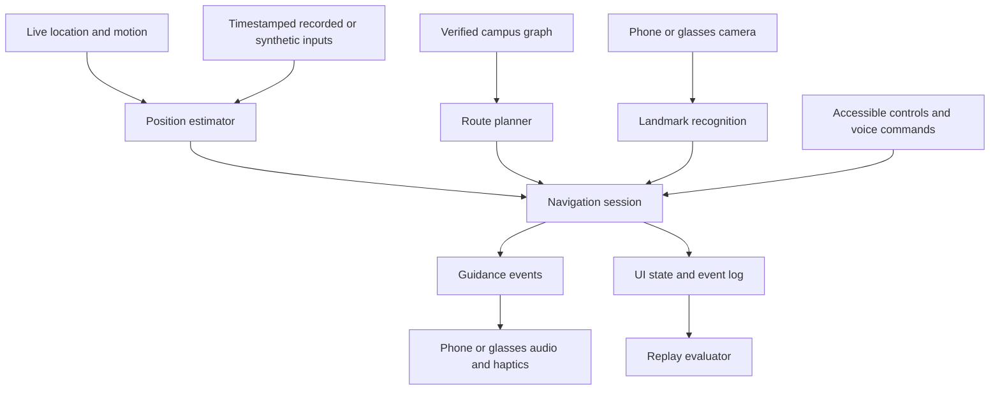

> Historical planning baseline. Current implementation and remaining work are tracked in `semester-one/IMPLEMENTATION_STATUS.md` and `REQUIREMENTS_TRACEABILITY.md`.

# Argus: complete product and delivery plan

Planning baseline: November 12, 2026. This is a proposed implementation plan, based on source inspection and the supplied senior-project report. It does not certify current device behavior or change the application. Existing uncommitted application work is preserved.

## 1. The product we are building

Argus helps a blind or low-vision pedestrian travel between verified outdoor campus entrances using accessible route selection, spoken directions, haptics, route recovery, and optional wearable input and output. The iPhone runs the navigation system. Glasses extend its camera and audio capabilities. An optional watch provides another control and feedback surface.

The complete first release covers a clearly documented TSU study area: 3–5 verified routes, each approximately 200–600 m, with connected alternatives where rerouting is claimed. It supports the whole journey, including denied permissions, uncertain positioning, a wrong turn, loss of a wearable, and arrival at the intended entrance. Coverage expands only after the same checks pass on new paths.

Primary journey: open Argus → choose an entrance → review route and preferences → confirm starting position → start guidance → hear timely instructions → recover if needed → confirm arrival → end session.

Success means a person can complete that journey without looking at the map and without developer intervention, within the conditions actually tested. More sensors or more screens do not independently make the product more complete.

The supplied report is reference material, not a new instruction to implement every statement immediately. Chapter 2 provides a useful proposed requirements baseline. Chapter 1 includes a broader obstacle-sensing and device-independent vision; Chapter 3 focuses on an iPhone and compatible Meta glasses. Resolve those differences with the advisor before making final project commitments. Template abstract, robot implementation headings, sample database code, and sample mathematical appendices are not product requirements.

## 2. What exists and why it feels fragmented

These findings are from the current source, not a new simulator or field trial.

| Area | Current evidence | Gap to a finished experience |
|---|---|---|
| Entry point | `MainTabView` presents Home, Record, Sensors; Home opens `RouteReplayView` | Home is a simulation rather than destination selection |
| Simulated guidance | One bundled Boyd Hall–library polyline; synthetic normal, missed-turn and noisy-fix scenarios; turn speech | No complete live navigation session; simulated distance drives progress and arrival |
| Recording | `WalkRecorder` saves raw GPS and reported accuracy, optional motion/heading, and manual marks as local JSON | Recording is a development tool; add schema version, route/dataset IDs, retention/deletion, interruption recovery |
| Recorded replay | `WalkReplayView` replays timestamps and runs the deviation detector | It does not run the synthetic view's whole turn/progress workflow; no shared end-to-end engine or expected-event report |
| Route logic | `SimulationRoute` loads one polyline; `TurnInstruction` derives bends | A polyline is not a connected accessible pedestrian graph or a route planner |
| Deviation | 12 m exit / 5 m return thresholds and three readings | Ignores sample accuracy and elapsed time; does not calculate a replacement route |
| Sensors | Diagnostic sensor dashboard plus recording services | Multiple owners of sensor behavior; measurements are not yet a validated positioning estimate |
| Maps | All active maps use MapKit; unused MapLibre code and dependency removed | Keep navigation calculations independent of rendering |
| Wearables and recognition | No corresponding implementation found in reviewed Swift files | Hardware capability proof, adapters, recognition pipeline, and device tests remain |

The central missing piece is a shared navigation session. Today, the screens own much of the logic. The next architecture should make screens display session state while live inputs, recorded inputs, and synthetic inputs feed the same engine.

## 3. Concepts that must stay distinct

| Concept | Meaning in Argus |
|---|---|
| Map | Visual background and geographic features. A displayed sidewalk has not necessarily been checked for accessibility. |
| Pedestrian graph | Verified intersections/entrances connected by paths with direction, access, stairs, closures, and other attributes. |
| Planned route | The particular sequence of graph edges chosen for a destination and user preferences. |
| Recorded walk | Timestamped observations of where a device reported being. It is evidence, not automatically a valid route. |
| Position estimate | Best available location, route segment, movement direction and uncertainty, derived from observations. |
| Map matching | A hypothesis about which path the user is on. Preserve raw positions so matching cannot hide a deviation. |
| Rerouting | Calculating a new valid graph path. An off-route warning alone is not rerouting. |
| Landmark recognition | Identifying a mapped sign, entrance or other selected feature to supply context. |
| Obstacle detection | Estimating an obstruction in the user's travel corridor. This needs separate sensing, ground truth, latency and missed-hazard evaluation. Landmark labels do not establish obstacle clearance. |
| Heading | Phone orientation, travel direction and head direction are different. A phone in a pocket cannot be assumed to face the walking direction. |

Do not promise curb-level precision from a visually smooth marker. Do not interpret an absent detection as a clear path. Do not issue a crossing-clearance instruction based on GPS or a recognized crosswalk. These are concrete limits of the proposed guidance behavior.

## 4. Release boundaries

**Release A — coherent phone navigation:** destination search, entrance-specific route preview, avoid-stairs preference, verified graph routing, live progress, speech/haptics, repeat/where-am-I/pause/stop, uncertainty handling, rerouting where the graph supports it, local persistence, and identical replay processing. First prove one route, then all 3–5 study routes.

**Release B — complete senior-project system:** Release A plus verified glasses capabilities with phone fallback, a small evaluated landmark model, supported voice commands, synchronized sensor/video replay, accessibility trials, and reproducible delivery. Glasses and recognition remain planned core project work; doing the phone first does not silently remove them.

**Release C — broader deployment:** larger maintained coverage, campus data update ownership, distribution/support process, compatibility matrix, and longitudinal reliability evidence. A research prototype passing a few trials is not automatically ready for general independent travel.

**Separate research track:** general obstacle detection, depth/distance sensing, cross-platform runtime, indoor navigation, and additional custom hardware. Keep requirements and evaluation separate. If obstacle detection is an assessed core deliverable, scope a specific hazard set and hardware immediately and re-estimate the schedule. Do not hide it inside the landmark model.

Apple Watch remains optional, consistent with the report. Accounts, cloud tracking, social features, and an LLM navigation agent are not needed to finish this product.

## 5. The user-facing application

Use four tabs in this order: **Home, Simulate, Record, Profile**. Open directly to Home. Home provides a clean map and voice-first destination selection; Simulate contains curated presentation demonstrations; Record saves walks and metrics; Profile holds the user image, settings, help and sensor tools. The profile image at Home's top right opens the same Profile destination. Saved places belong within Home and Profile rather than a separate tab. The detailed interaction specification is in [TAB_DESIGN.md](TAB_DESIGN.md).

| Screen | Content and behavior |
|---|---|
| First run | Plain explanation of coverage and limitations; accessible setup; request permissions when the associated feature is used; demo available without location |
| Home | Clean map without a preloaded route; voice-first origin/destination selection, accessible search fallback, recent/favorite destinations, location readiness and top-right profile image |
| Simulate | Curated campus-image presentations, scenario selection, clearly labeled simulation, accessible playback and scenario results |
| Record | Start/stop/save walks, recording status, available metrics, saved-walk details, replay, export and deletion |
| Profile | Profile picture, preferences, device connections, privacy, help, sensors and other supporting tools |
| Destination | Entrance name, description, known hours/access conditions, verification date, favorite control |
| Route preview | Start and destination entrances; length and approximate duration; stairs/crossings and known gaps; avoid-stairs control; start button only when a supported route and usable start are available |
| Active guidance | Next instruction first; remaining distance; repeat, where-am-I, pause/resume and end; map as supporting information; accessible current-status announcement |
| Recovery | Clearly distinguish location uncertain, confirmed off-route, finding alternative, and no available mapped route; provide a useful next action for each |
| Arrival | Identify the mapped entrance; announce arrival once when position and progress support it; allow confirmation, repeat entrance description and end |
| Settings | Speech rate, supported haptics, accessibility preferences, device connections, downloads/data version, privacy and deletion, help |

All controls must work with VoiceOver, large text and nonvisual focus order. Never encode status by color alone. Test speech arbitration with VoiceOver: repeated screen announcements must not bury a route warning. Prefer a few learnable haptic meanings; validate whether left/right patterns can actually be distinguished on each device.

Voice commands: navigate to a known destination, repeat, where am I, pause, resume, end. Ambiguous names require confirmation. An unknown command must not alter the route. First implement an explicit listening control; investigate supported hands-free activation separately. Do not promise continuous locked-phone voice listening before demonstrating it on the selected device and OS.

## 6. One engine with replaceable inputs

Suggested responsibilities, implemented as ordinary Swift types rather than a new framework:

- `CampusDatasetStore`: loads a versioned graph and rejects invalid data with actionable errors.
- `RoutePlanner`: computes constrained paths and returns either a route or an explicit reason one is unavailable.
- `LocationProvider`, `MotionProvider`, `CameraProvider`, `CommandInput`, `GuidanceOutput`: interfaces with live, replay, phone and wearable implementations where applicable.
- `PositionEstimator`: validates age/accuracy, estimates segment/progress and uncertainty, retaining raw data alongside estimates.
- `NavigationSession`: owns destination, route version, session state, progress, deviation, rerouting, cue eligibility and arrival.
- `GuidanceCoordinator`: prioritizes events, suppresses duplicates, cancels stale queued speech, supports repeat and output fallback.
- `SessionRecorder` and `ReplayEvaluator`: record timestamped inputs/outputs and compare events against independently annotated expectations.

Session states: idle → planning → ready → navigating → arrived → ended. Navigating can enter paused, positionUncertain, offRoute or rerouting. Failed rerouting enters noMappedRoute. Stop is valid from every active state. A wearable disconnect changes device capability/output; it does not discard the journey. UI redraws do not restart sensors or reset progress.

Keep one session-owned location service during navigation. Adapt the recorder and diagnostics to observe that stream. Remove redundant dependencies only after their usages are migrated and the existing work is preserved. Default to the already active MapKit renderer initially; verify offline basemap needs and licensing before making a final rendering choice.

## 7. Campus data and routing

Build a mapping workflow that can be operated by a teammate: select study boundary → import source geometry → inspect on foot → edit nodes/edges/entrances → validate → second-person walkthrough → publish versioned data. Coordinate tapping alone is insufficient. A simple developer map editor plus structured forms/export can satisfy the mapping need before considering a separate web portal.

Minimum records:

- Node: stable ID, coordinates, type, spoken description and decision-point instructions.
- Edge: stable ID, endpoint IDs, full geometry, length, permitted direction, surface, stairs, slope/width when measured, access restrictions, closure status and verification provenance.
- Entrance: building and entrance IDs, connected node, door description/type, verified access information and hours if known.
- Landmark: stable ID, mapped coordinates, class/identity, permitted approach context and reference media provenance.
- Dataset: schema and release versions, study boundary, coordinate system, sources/attribution, survey dates, verifier, known gaps and change log.

Use explicit unknown values; missing information is not proof of accessibility. A no-stairs setting must exclude stair edges, and other required constraints must exclude unknown or conflicting edges according to the declared routing policy. Cane navigation and wheelchair access are different needs; do not collapse them into one unexplained accessible flag.

Validate unique IDs, coordinate bounds, references, geometry endpoints, nonzero lengths, required descriptions, reachable entrances and constrained connectivity. Include intentional disconnected and no-stairs fixtures. Reject or quarantine bad data rather than presenting a plausible-looking route.

Start with Dijkstra for the small graph. Exclude forbidden/closed edges before ranking the remaining routes by distance and declared preferences. Connect a reliable start to a compatible nearby edge, accounting for intermediate position and direction; do not snap across a building, road or inaccessible gap. Provide an explicit route-to-start limitation if the person is outside mapped coverage. Rerouting requires a connected alternative in surveyed data. Reversing a polyline alone does not verify reverse instructions or entrance access.

## 8. Positioning, instructions and recovery

1. Validate each fix's timestamp, coordinates and reported accuracy. Preserve original accepted observations and log rejected samples with reasons in test mode.
2. Estimate candidate graph edges using location, continuity, recent travel and useful heading evidence. Start with a transparent baseline; add sensor fusion only when replay/field comparisons show improvement.
3. Distinguish stationary orientation from travel direction. Avoid integrating phone acceleration into an assumed precise position without a validated drift model.
4. Advance progress using observed movement on a plausible edge sequence. Handle backtracking, parallel paths and loops. A progress timer must never establish live arrival.
5. Trigger surveyed maneuvers with configurable distance/time windows. The current fixed 35 m warning is a starting hypothesis, not a universal correct lead distance. Add prepare/action/recovery behavior and nearby-turn arbitration.
6. Make deviation evidence time-based and accuracy-aware. Three readings at 10 Hz represent a different duration from three readings at 1 Hz. Separate poor GPS from reliable departure; use hysteresis and cooldowns.
7. On reliable departure, announce once, find a new valid mapped path and replace stale instructions. If location is uncertain or no path exists, communicate that state without inventing a straight-line shortcut.
8. Arrive only near the intended entrance with consistent route progress and adequate confidence. If precision is insufficient, say near destination and provide the known entrance description rather than claiming exact arrival.

Guidance event types should include prepareTurn, turn, crossingAhead, entranceApproach, positionUncertain, offRoute, rerouteReady, noMappedRoute, deviceChanged and arrived. Priority is reliability/recovery first, imminent maneuver next, contextual landmark last. Each event carries session/route IDs, time, trigger evidence, delivery status and a deduplication key.

## 9. Glasses, camera recognition and optional watch

Run a short capability investigation at the beginning, even though integration follows the phone baseline. Record exact glasses model, firmware, iOS version, toolkit version, account/developer access and distribution restrictions. Prove connection, camera delivery, microphone access, speech routing, permission denial, screen-lock behavior, disconnect and reconnect separately. Never infer all of those from a Bluetooth pairing screen.

Meta's official toolkit information describes mobile integration with camera/video and audio capabilities. The actual supported combination still needs device testing. Use the supported toolkit rather than designing a raw BLE video protocol. If custom distance sensors become a requirement, their transport and data contract are separate work.

Fallback is capability-specific: phone speech can continue after glasses loss; a pocketed phone camera cannot supply the same viewpoint as worn glasses. Announce recognition unavailability rather than silently claiming equal camera coverage. Keep the current route/session and remove obsolete queued messages on output changes.

For recognition, begin with 2–3 useful classes/landmarks before expanding toward the report's maximum of 10. Collect at least the report's 100 images per class as a baseline, with additional collection driven by evaluation. Split by capture session, viewpoint and location so near-duplicate frames do not leak across training and test sets. Use negative examples and an unknown outcome. Choose classification for identifying a suitable framed landmark, or detection when objects must be localized; the two have different labels and evaluation.

Train off-device, record dataset/model versions, integrate Core ML, then gate announcements using confidence, geographic consistency, repeated observations and cooldown. Test unfamiliar look-alike signs and absent landmarks. A generic door label cannot identify a particular building entrance. Keep recognition advisory initially; any later position correction must be uncertainty-aware and separately validated.

Synchronize video/frame timestamps to sensor time with documented offset/drift. Measure capture-to-announcement latency, precision/recall and confusion by class, dropped frames, thermal behavior and battery use on the target phone. Add watch haptics/quick commands only after phone and glasses paths pass; navigation must remain usable without it.

## 10. Replay, evaluation and release gates

Live, synthetic and recorded input must drive the same session logic. Replaying faster changes wall-clock speed, not sensor timestamps or detection semantics. Include route/dataset version, recording source, hardware/OS, timestamp basis, ground-truth marks, sensor observations and generated guidance in each test bundle. Keep simulated and measured recordings visibly distinguished.

Required scenarios: normal walk, missed turn and rejoin, one outlier, sustained poor accuracy, stale/gapped updates, stationary jitter, backtracking, parallel sidewalk, wrong starting edge, no accessible path, closure, locked screen, phone call/audio interruption, denied permission, glasses loss, false landmark, arrival near a different entrance, stop/restart and app interruption. Some are replay fixtures; screen-lock, audio routing and hardware behaviors need real-device tests.

The following are proposed engineering gates, not achieved results or proof of general travel safety. Calibrate them with actual route conditions and user/advisor review before freezing the evaluation protocol.

| Area | Proposed acceptance evidence |
|---|---|
| Dataset | Zero structural validation errors; all required entrances reachable under their claimed constraints; every study route independently checked |
| Routing | All fixture routes respect hard constraints; blocked/disconnected cases return no route; rerouting never invents an edge |
| Replay | Repeat runs produce the same ordered navigation events; 1× and accelerated playback agree in sensor-time results |
| Outliers | No off-route event for the isolated-outlier and stationary-jitter reference fixtures |
| Deviation | For deliberately sustained, confidently observable departures, initial target ≥90% detected within 10 seconds of annotated threshold crossing; report sample count and distribution |
| False warnings | Initial target no more than one false off-route warning per 30 minutes of accumulated on-route field time; report raw count and exposure |
| Instructions | ≥95% of annotated decision points receive an instruction in their predefined lead window; zero contradictory turn messages or crossing-clearance claims |
| Arrival | No premature arrival in negative fixtures; intended entrance arrival verified on every study route |
| Phone workflow | Three consecutive supervised completions per study route without crash or developer intervention; log human assistance and wrong turns even when a route is completed |
| Recognition | Initial target ≥95% precision for announced landmark identities on held-out sessions; report recall, per-class counts and p95 capture-to-announcement latency, with a provisional ≤2 s latency budget |
| Accessibility | Destination → start → repeat → where-am-I → recover → end completed with VoiceOver; separately document voice-only and haptic-only results and limitations |
| Wearables | Repeated disconnect/reconnect and permission tests preserve route; announce output loss and demonstrate phone speech fallback with an initial ≤5 s target |
| Endurance | Complete a 60-minute real-device session including screen lock and interruptions; report battery drain and thermal state against a baseline |
| Reproducibility | A teammate outside implementation builds, installs and performs the documented sample journey |

Device-reported accuracy is an uncertainty estimate, not measured position error. Evaluate position against independently identified reference points and report reference quality. Record participant count separately from walk count; repeated trials by one developer are not evidence of usability across blind and low-vision users.

Use supervised daylight trials on approved routes, with an accompanying sighted person and explicit stop procedure, as proposed in the report. Obtain applicable campus/advisor research authorization before recruiting participants. Begin with engineering walks, then formative sessions with intended users and relevant mobility expertise; include the resulting design changes. Existing mobility aids remain in use.

## 11. Privacy, offline operation and maintenance

Keep core navigation local: versioned graph, route planning, speech and packaged model. Demonstrate airplane-mode routing and guidance separately from basemap availability and speech/voice-recognition availability. If an offline basemap or offline voice command path is required, verify it explicitly on the selected stack. Do not equate bundled GeoJSON with a complete offline experience.

Logging is opt-in outside development. Request camera/microphone/location access in context; ordinary navigation should not require saving video. Protect saved data using supported device storage protections, offer deletion of recordings/media, exports only on explicit action, and document retention. Remove/blur recognizable faces in shared training images. Exclude private traces and identifying participant data from public source control.

Assign a campus dataset owner and a release approver. Every change records provenance, affected routes, schema compatibility and validation results. Provide closure handling and stale-data messaging. Keep a tested previous dataset for rollback; never replace a working graph with a partially imported update. Define support contact, issue reporting and a supported device/OS matrix before broader distribution.

## 12. Delivery sequence and effort

Assumption: a two-person student team with part-time availability. Estimates below are team effort ranges in focused person-weeks; they are planning estimates, not calendar promises. Hardware procurement, permissions, recruitment, academic breaks and failed field gates can extend elapsed time. Re-estimate after the first complete live route. Do not divide effort by two mechanically because much of the work depends on earlier results.

| Phase | Main outcome | Effort | Exit gate / dependency |
|---|---|---|---|
| 0. Scope and capability baseline | Confirm study area, requirements, device compatibility; snapshot current work; create issue/evidence register | 0.5–1 | Agreed release scope, install/build baseline, hardware capability findings or explicit blocker |
| 1. Shared engine and first route | Extract session/events from views; connect live and replay; map first route into graph; simple destination/preview/active screens | 2–3 | Same journey runs in live and replay; phone turn/repeat/stop/arrival demonstrated |
| 2. Reliable route recovery | Data validation, constrained planner, uncertainty, time-aware deviation, real rerouting, shared regression fixtures | 2–3 | Wrong-turn, bad-GPS, no-path and backtracking gates pass |
| 3. Complete phone release | 3–5 routes, mapping workflow, favorites/settings, voice/haptics, screen-lock/audio behavior, privacy and offline checks | 2–4 | Release A passes full route and accessibility matrix |
| 4. Glasses integration | Supported input/output adapters, device status, disconnect recovery | 1–3 | Hardware matrix and fallback demonstrated; requires device/toolkit access |
| 5. Landmark release | Dataset, annotations, held-out evaluation, model, synchronized frame replay, contextual announcements | 3–5 | Recognition and endurance gates pass on phone and supported glasses views |
| 6. Product validation and handoff | Intended-user feedback, regression fixes, docs/report, independent install and release evidence | 2–3 | Release B gates pass; incomplete requirements explicitly recorded |
| Optional watch | Haptics and repeat/where-am-I/stop | 1–2 | Does not delay mandatory release gates |

Mandatory work totals roughly 12.5–22 person-weeks before contingency, with overlap possible for survey/data collection and hardware investigation. Reserve approximately 25% contingency and reassess actual velocity. This is consistent with a semester-scale project rather than an eight-day conversion into the full product. The report's May 2027 date is a planning horizon to confirm, not evidence of the official submission deadline.

Proposed responsibility split: one lead owns navigation/session/UI; the other owns survey/data validation, replay annotations and recognition preparation. Both review accessibility behavior, field routes and release gates. Hardware integration gets one clear owner after the capability spike. Every work item needs an owner, dependency, observable result and evidence link.

## 13. Immediate implementation backlog

Complete in this order; do not start a visual redesign across all diagnostic screens first.

1. **P0 — preserve and baseline:** review the existing modified/untracked files; establish a build/install baseline; document which recordings are measured versus synthetic. Done: reproducible baseline and a current behavior inventory.
2. **P0 — define the journey:** implement Home, Simulate, Record and Profile in that order, with sensor tools under Profile. Done: Home → destination → preview → active guidance → end flow with explicit live/demo mode, plus the planned presentation and recording destinations.
3. **P0 — extract `NavigationSession`:** move progress, cue emission, deviation and arrival from views into one engine; inject input clock/providers and guidance outputs. Done: live and both replay modes invoke the same logic.
4. **P0 — first graph and validator:** represent the existing route as nodes/edges plus entrance records; walk-check directions and important cues. Done: graph loads with zero validation errors and yields the expected constrained path.
5. **P0 — live guidance:** connect the existing GPS stream; handle denied/poor location; add repeat, where-am-I and stop; log cue timing. Done: a supervised end-to-end first-route trial with saved evidence.
6. **P1 — real recovery:** add surveyed alternative edges, time/accuracy-aware deviation and rerouting. Done: intentional wrong turn produces a valid replacement path, or an honest no-path response.
7. **P1 — full phone workflow:** haptics, voice, screen-lock/audio behavior, saved preferences, recording deletion and offline checks. Done: phone acceptance matrix passes.
8. **P1 — hardware spike and adapters:** run the early capability investigation, then integrate verified capabilities after session stability. Done: retained journey after connection loss.
9. **P1 — recognition pipeline:** collect/evaluate the initial small class set, then integrate frame input and event gating. Done: held-out metrics and contextual announcements meet the frozen targets.
10. **P1 — finish evidence and documentation:** regression report, field results, limitations, user guide and independent installation. Done: final release checklist and requirements matrix close honestly.

## 14. Near-term demonstration checkpoint

Earlier planning mentioned November 20; reconfirm whether that presentation date is still current. If it is, use November 13–20 as a demonstration window, not the full product deadline:

- November 13–14: baseline current work, choose the first verified route, create session/events and basic destination/preview screens.
- November 15–16: connect live inputs and replay to the same engine; implement repeat/where-am-I/stop and entrance-aware completion.
- November 17: supervised first-route trial; annotate expected turns, a deviation and poor-location behavior. If real rerouting is incomplete, present the warning as a warning.
- November 18–19: fix demonstrated failures, run replay regressions, freeze the demo and prepare measured results plus a recorded fallback.
- November 20: show the end-to-end journey, one recovery scenario, test evidence and the remaining Release A/B backlog. If a gate fails, show the bounded result and failure evidence.

## 15. Traceability to the supplied report

These are proposed mappings, not a declaration that every requirement has been met.

| Chapter 2 group | Delivery location | Evidence required |
|---|---|---|
| R1 campus mapping | Phases 1–3, 5 | Approved study boundary, 3–5 surveyed routes, annotated graph/entrances, second-person check, landmark image inventory |
| R2 import/validation | Phases 1–2 | Schema, validator output and graph connectivity tests |
| R3 accessible UI | Phases 1, 3, 6 | Destination workflow, supported voice commands, VoiceOver walkthrough |
| R4 positioning | Phases 1–3 | Raw/estimated positions, uncertainty behavior and measured tracking comparison |
| R5 routing/recalculation | Phase 2 | Constrained route fixtures and field wrong-turn/recovery results |
| R6 speech/haptics | Phases 1, 3, 6 | Event timing logs, repeat behavior, distinguishability results |
| R7 glasses | Phase 4 | Capability matrix, connection/audio/frame tests, fallback evidence |
| R8 recognition | Phase 5 | Image/model versions, held-out metrics, frame latency and context gating |
| R9 optional watch | Optional phase | Device tests and commands, or explicitly omitted optional scope |
| R10 recording/replay | Phases 1–2, 5 | Synchronized input bundles, expected events and automated difference report |
| R11 supervised trials | Phases 3, 6 | Written procedure, route completion, errors, recovery, position and cue metrics |
| R12 accessibility/limits | Phases 3, 6 | VoiceOver/voice/haptic results, permission/data handling and documented limits |
| R13 delivery | Phase 6 | Buildable source, versioned data/model, allowed recordings, user/technical guides and independent setup |

Maintain one row per detailed requirement in the issue tracker as work begins: requirement ID, interpretation, owner, planned release, test/evidence, current status and approved change if any. Any reduction in the proposed academic scope must be visible and discussed with the advisor.

## 16. What counts as finished

Release A is complete when the entire phone journey works across the verified study area and its failure paths pass the agreed gates. Release B is complete when glasses, recognition, replay, accessibility evaluation and the handoff are also demonstrated. Optional watch work does not compensate for a missing mandatory journey.

Deliver a buildable repository and install instructions; versioned campus graph and attribute guide; labeled images/model with sharing constraints; replay fixtures and evaluator; supervised trial results with raw denominators; accessibility/device matrix; user guide; architecture and limitations; and a short evidence-backed demonstration. Replace report placeholders with the actual implementation and measured results. An unimplemented requirement remains explicitly open.

## Sources and verification boundaries

- Supplied `Senior_Project_Latex_Template (5).pdf`: Chapter 1 objectives, Chapter 2 proposed requirements (printed pp. 11–23), Chapter 3 design and Figure 3.1 (printed pp. 24–30). Text reviewed and architecture figure visually inspected. The document mixes proposed work with template content.
- Current local Swift source and Xcode project: inspected November 12, 2026. No build, simulator run or real-device trial was performed for this planning task.
- [Meta Wearables Device Access Toolkit FAQ](https://developers.meta.com/wearables/faq/) and [toolkit overview](https://developers.meta.com/wearables/device-access-toolkit/): official discovery sources for the capability investigation; exact hardware/toolkit behavior remains to be verified.
- [Apple: handling location updates in the background](https://developer.apple.com/documentation/corelocation/handling-location-updates-in-the-background) and [background updates property](https://developer.apple.com/documentation/corelocation/cllocationmanager/allowsbackgroundlocationupdates): background navigation needs deliberate lifecycle/configuration work and device validation.
- Earlier project planning favored measurable phone progress while glasses were unavailable. Current hardware availability and presentation dates were not reverified; this plan preserves that dependency strategy without assuming the old status remains current.
