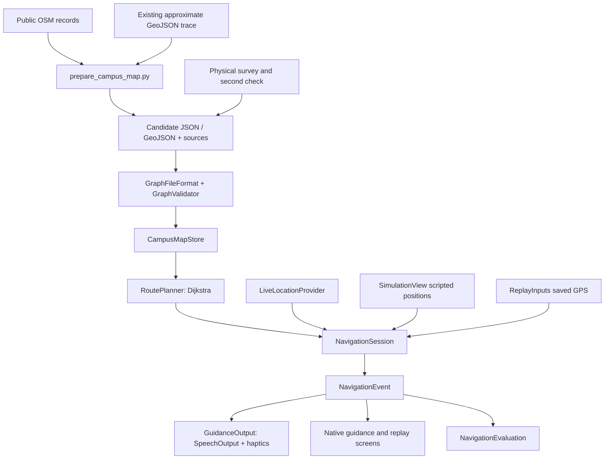

# How the semester-one code works

Read the files in this order: `CampusGraph.swift`, `GraphValidator.swift`, `RoutePlanner.swift`, `NavigationSession.swift`, then `NavigationController.swift`. Important calculations and lifecycle decisions have comments beside them.

## Graph and routing

MapKit draws maps; it does not choose Argus graph paths. `RoutePlanner` uses Dijkstra, with deterministic tie breaking, physical distance, directionality, hard restrictions and configurable penalties. Unknown stairs are excluded when stair avoidance is requested. Unknown access is controlled separately. A candidate route may be previewed or simulated; live guidance requires a non-demo route whose nodes/edges and destination carry verification evidence.

`MapGeometry` converts longitude/latitude differences to local metres for projection, using `t=clamp((P-A)·(B-A)/|B-A|²,0,1)` and `Q=A+t(B-A)`. P is raw position, A/B are segment endpoints, Q is the projected position. Haversine distances supply lengths. The baseline assumes a compact campus area, not polar or antimeridian routes.

## Shared session

`NavigationSession.receive` checks input source, coordinates, time, reported accuracy and plausible movement before calculating progress. It retains eight recent accepted positions. It does not fuse accelerometer, gyroscope or compass data. Distant route sections with indistinguishable proximity produce uncertainty instead of a confident match.

The original `OffRouteDetector` retains 12 m / 5 m hysteresis and three-reading confirmation. Session code adds uncertainty bounds and at least two seconds between the first and third counted fixes. A gap clears confirmation. Stale/bad data produces uncertainty, not a fabricated route departure. Turn warnings use a 35 m lead; confirmed arrival requires proximity to the endpoint, near-complete route progress, starting near the selected origin, three readings and two seconds.

Rerouting is conservative: only a uniquely matched verified node within 5 m including accuracy can start a new verified path. Partial-edge rerouting and reliable travel-heading inference remain open. The engine does not invent a straight connector across unmapped space.

## Inputs, output, and lifecycle

`LiveLocationProvider` owns foreground Core Location. `NavigationController` adapts the value-type session to SwiftUI and ends capture when leaving the guidance screen or becoming inactive. `SimulationView` and `WalkReplayView` feed the same session directly; their timers affect presentation speed only. All saved fixes are processed in stable timestamp order.

`GuidanceOutput` receives structured events and reuses `SpeechOutput`. The new voice command parser recognizes a small exact vocabulary for repeat, current location and stop. Microphone recognition still uses Apple's speech service. Recorded graph snapshots preserve replay context. Older JSON remains readable and uses the explicitly labeled approximate reference route.

## Semester-two interfaces

`LandmarkObservation` is a data contract with identity, confidence, time, estimated coordinate and source. It is not connected to position correction. A future recognizer must verify identity/location consistency and latency before producing advisory events. A future glasses adapter can supply frames to that recognizer and audio/commands to existing services. A future Watch adapter can consume `NavigationEvent`. No hardware SDK or fake connected-device state is included.

## Limitations

No physically verified campus route or alternative has been supplied. Local routing works without a server, but the basemap and speech recognition may need network access. Full offline behavior is not established. Live navigation and recording are foreground-only. Motion fusion, video synchronization, landmark recognition, glasses, watch, field calibration, VoiceOver usability and supervised user trials are incomplete.
